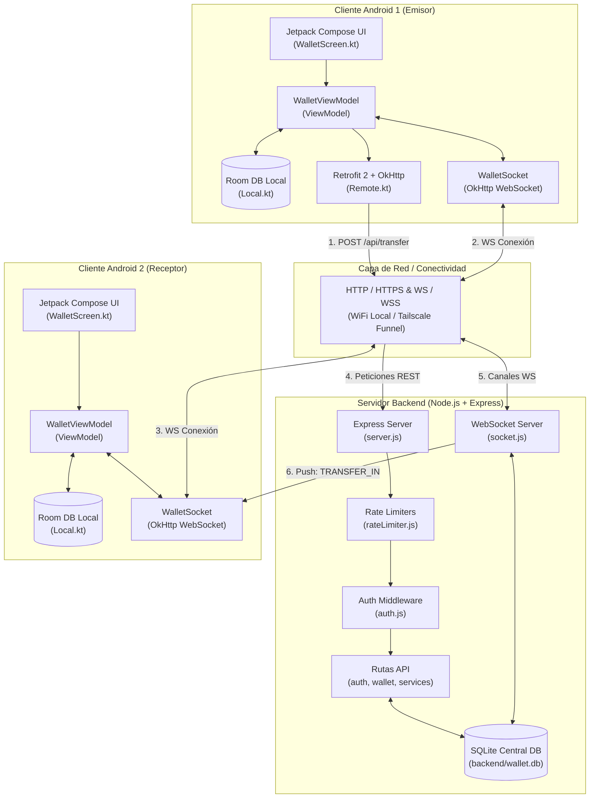
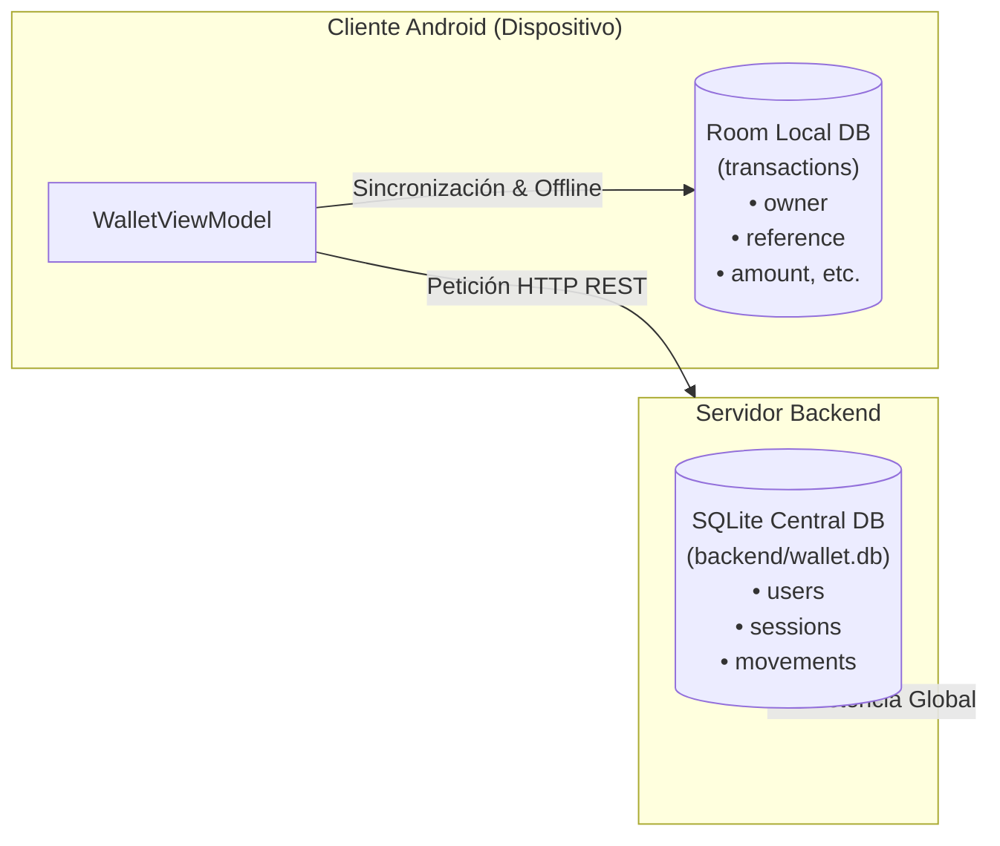

# ClickKash - Carvajal - Reimundo – Billetera Móvil Distribuida

**ClickKash** es una plataforma de billetera móvil distribuida cliente-servidor, compuesta por una aplicación móvil nativa para Android (desarrollada con **Kotlin** y **Jetpack Compose**) y una API REST con servidor **WebSocket** en segundo plano (desarrollada en **Node.js** con **Express** y **SQLite** nativo).

El sistema ofrece una experiencia financiera distribuida en tiempo real, permitiendo la gestión de cuentas, autenticación mediante contraseñas seguras o PIN, depósitos, retiros, transferencias entre usuarios (P2P) con notificación push instantánea y pago de servicios básicos.

---

## Índice

- [1. Presentación del Proyecto](#1-presentación-del-proyecto)
- [2. Funcionalidades Principales](#2-funcionalidades-principales)
- [3. Arquitectura del Sistema](#3-arquitectura-del-sistema)
- [4. Pila Tecnológica](#4-pila-tecnológica)
- [5. Estructura de Directorios](#5-estructura-de-directorios)
- [6. Persistencia de Datos: SQLite y Room](#6-persistencia-de-datos-sqlite-y-room)
- [7. Retrofit y OkHttp: Comunicación del Cliente Android](#7-retrofit-y-okhttp-comunicación-del-cliente-android)
- [8. Corrutinas y Programación Asíncrona](#8-corrutinas-y-programación-asíncrona)
- [9. Seguridad](#9-seguridad)
- [10. Instalación y Ejecución](#10-instalación-y-ejecución)
- [11. Pruebas y Demostración](#11-pruebas-y-demostración)
- [12. Evidencias Técnicas](#12-evidencias-técnicas)

---

## 1. Presentación del Proyecto

### Propósito General
Proporcionar una solución móvil de gestión financiera personal y transferencias distribuidas, ágil y transparente, que combine persistencia local en el dispositivo para consulta inmediata del historial offline y sincronización en tiempo real mediante WebSockets con un backend centralizado.

### Problema que Resuelve
- **Inmediatez en transferencias P2P:** Notificación instantánea en el dispositivo receptor cuando se envía dinero desde otra cuenta, sin necesidad de actualizar la pantalla manualmente.
- **Disponibilidad del historial local:** Almacenamiento local del historial de transacciones mediante Room, permitiendo revisar movimientos sin depender de la latencia del servidor en cada renderizado.
- **Seguridad en dispositivos móviles:** Mecanismos de autenticación en dos capas (contraseña fuerte y PIN numérico rápido de 4 dígitos), con protección contra ataques de fuerza bruta (Rate Limiting) y control estricto de sesión única activa.

### Tecnologías Clave
- **Frontend Móvil:** Android Nativo, Kotlin, Jetpack Compose, ViewModel, StateFlow, Room, Retrofit, OkHttp, Coroutines.
- **Backend:** Node.js (v22.13+), Express, WebSocket (`ws`), SQLite nativo (`node:sqlite`), `express-rate-limit`, Criptografía nativa (`scrypt`).

---

## 2. Funcionalidades Principales

### Implementadas al 100%
- **Registro de usuarios:** Creación de cuenta asignando automáticamente un identificador único de cuenta (`ACC-XXXX`), validando correo único y contraseña segura (mínimo 8 caracteres, mayúscula, minúscula y número).
- **Autenticación doble:** Inicio de sesión mediante correo y contraseña, o ingreso rápido mediante PIN numérico de 4 dígitos.
- **Gestión de PIN:** Configuración y eliminación de PIN de acceso desde la cuenta autenticada.
- **Control de Sesión Única (Single Session Enforcement):** Detección de sesiones activas en otros dispositivos con opción de forzar inicio de sesión (`force: true`), expulsando automáticamente las sesiones previas vía WebSocket.
- **Consulta de Saldo y Movimientos:** Visualización del saldo actual y sincronización del historial de transacciones.
- **Operaciones Financieras:**
  - **Depósitos:** Recarga de fondos a la cuenta propia.
  - **Retiros:** Extracción de saldo previa validación de fondos suficientes.
  - **Validación previa de cuentas:** Consulta asíncrona de existencia y titularidad de cuenta destino (`/api/account/validate`).
  - **Transferencias P2P:** Envío de dinero entre cuentas registradas con actualización atómica en base de datos.
  - **Pago de Servicios:** Pago de facturas con validación de contrato (`LUZ-XXXXXX`, `AGUA-XXXXXX`, `NET-XXXXXX`, `OTR-XXXXXX`).
- **Notificaciones WebSocket en Tiempo Real:** Emisión automática de eventos al receptor cuando recibe una transferencia (`TRANSFER_IN`) o cuando su sesión es invalidada (`SESSION_REPLACED`).
- **Persistencia Local (Room):** Guardado automático e indexado del historial de transacciones en la base de datos interna SQLite del dispositivo móvil por cada usuario.

---

## 3. Arquitectura del Sistema

El sistema sigue una arquitectura **Cliente-Servidor Distribuida**, donde la lógica financiera centralizada y la consistencia de saldo residen en el **Backend Node.js + SQLite Central**, mientras que la interfaz interactiva y el historial local se gestionan en el **Cliente Android** usando **Jetpack Compose** y **Room**.



### Componentes Clave:
1. **Cliente Android (Kotlin + Compose):**
   - **`ui/`:** Pantallas construidas con Jetpack Compose (`AuthScreen`, `PinScreen`, `WalletScreen`, `WelcomeScreen`).
   - **`WalletViewModel`:** ViewModel central que orquesta el estado reactivo (`StateFlow`), las invocaciones a corrutinas en `Dispatchers.IO` y el mapeo de eventos.
   - **`data/local/Local.kt`:** Implementación de Room para almacenar localmente las transacciones propias del usuario activo.
   - **`data/remote/Remote.kt`:** Cliente HTTP Retrofit para REST y `WalletSocket` para comunicación bidireccional por WebSocket.
2. **Backend (Node.js + Express + SQLite):**
   - **`server.js`:** Servidor HTTP y servidor WebSocket escuchando en el puerto `3000`.
   - **`src/database/db.js`:** Manejo de base de datos relacional SQLite mediante el módulo nativo `node:sqlite` (`DatabaseSync`), implementando transacciones ACIDs (`BEGIN`, `COMMIT`, `ROLLBACK`).
   - **`src/websocket/socket.js`:** Registro de sockets activos asociados a la cuenta del usuario para notificaciones instantáneas (`push`).

---

## 4. Pila Tecnológica

| Tecnología | Versión Comprobada | Responsabilidad en el Proyecto | Ubicación Real en el Proyecto |
|---|---|---|---|
| **Kotlin** | `2.0.21` / Compiler | Lenguaje de programación principal de Android | `app/build.gradle.kts` |
| **Android SDK** | Compile: `35` / Min: `24` | Entorno de ejecución móvil | `app/build.gradle.kts` |
| **Jetpack Compose** | BOM `2024.12.01` | Declaración de Interfaz de Usuario (UI) | `app/src/main/java/com/melanie/billetera/ui/` |
| **Lifecycle & ViewModel** | `2.8.7` | Gestión de estado y ciclo de vida de UI | `app/src/main/java/com/melanie/billetera/WalletViewModel.kt` |
| **Room** | `2.6.1` | Base de datos SQLite local en el dispositivo | `app/src/main/java/com/melanie/billetera/data/local/Local.kt` |
| **KSP (Kotlin Symbol Processing)** | plugin | Generador de código para Room DAO | `app/build.gradle.kts` |
| **Retrofit** | `2.11.0` | Cliente HTTP tipo seguro para consumo de API REST | `app/src/main/java/com/melanie/billetera/data/remote/Remote.kt` |
| **OkHttp** | `4.12.0` | Motor de red HTTP, Interceptor Bearer y cliente WebSocket | `app/src/main/java/com/melanie/billetera/data/remote/Remote.kt` |
| **Kotlin Coroutines** | `1.9.0` | Programación asíncrona y multihilo en Android | `app/src/main/java/com/melanie/billetera/WalletViewModel.kt` |
| **Node.js** | `>=22.13` | Entorno de ejecución del servidor backend | `backend/package.json` |
| **Express** | `^4.21.2` | Framework web para rutas HTTP REST | `backend/package.json` |
| **SQLite Nativo (`node:sqlite`)** | Módulo nativo Node.js | Base de datos relacional central del backend (`wallet.db`) | `backend/src/database/db.js` |
| **`ws` (WebSocket)** | `^8.18.0` | Servidor WebSocket para notificaciones push en tiempo real | `backend/src/websocket/socket.js` |
| **`express-rate-limit`** | `^8.7.1` | Protección de endpoints contra ataques de fuerza bruta | `backend/src/middleware/rateLimiter.js` |

---

## 5. Estructura de Directorios

```text
AppClickKash_Carvajal_Reimundo-main/
├── README.md                                    # Documentación técnica principal
├── build.gradle.kts                             # Configuración Gradle raíz del proyecto
├── settings.gradle.kts                          # Módulos y repositorios de Gradle
├── app/                                         # Módulo de la aplicación Android
│   ├── build.gradle.kts                         # Dependencias, SDKs y plugins de Android
│   └── src/main/
│       ├── AndroidManifest.xml                  # Permiso INTERNET y configuración de la app
│       ├── java/com/melanie/billetera/
│       │   ├── MainActivity.kt                  # Activity principal
│       │   ├── WalletViewModel.kt               # ViewModel (Lógica de negocio, Corrutinas, StateFlow)
│       │   ├── data/
│       │   │   ├── local/Local.kt               # Room: TransactionEntity, TransactionDao, AppDatabase
│       │   │   └── remote/Remote.kt             # Retrofit: WalletApi, OkHttpClient, WalletSocket
│       │   └── ui/
│       │       ├── AuthScreen.kt                # Pantalla de Login / Registro por Contraseña
│       │       ├── PinScreen.kt                 # Pantalla de Login por PIN
│       │       ├── WalletScreen.kt              # Pantalla principal (Operaciones, Historial, Saldo)
│       │       ├── WelcomeScreen.kt             # Pantalla de Bienvenida
│       │       └── theme/Theme.kt               # Tema visual Jetpack Compose
│       └── res/                                 # Dibujables, cadenas y temas en XML
├── backend/                                     # Servidor backend Node.js
│   ├── package.json                             # Dependencias (Express, ws, express-rate-limit)
│   ├── server.js                                # Servidor Express + HTTP + WebSocket
│   ├── wallet.db                                # Base de datos SQLite central del servidor
│   ├── postman_collection.json                  # Colección Postman para pruebas de API
│   └── src/
│       ├── database/db.js                       # Conexión SQLite, esquemas DDL y sentencias
│       ├── middleware/
│       │   ├── auth.js                          # Middleware de token Bearer
│       │   ├── errorHandler.js                  # Manejador global de errores
│       │   └── rateLimiter.js                   # Limitador de intentos para login y PIN
│       ├── routes/
│       │   ├── auth.routes.js                   # Rutas /api/auth (login, register, pin)
│       │   ├── services.routes.js               # Rutas /api/services/pay
│       │   ├── user.routes.js                   # Rutas /api/me y /api/movements
│       │   └── wallet.routes.js                 # Rutas /api/deposit, /api/withdraw, /api/transfer
│       ├── services/userService.js              # Lógica de usuarios, sesiones y PIN
│       ├── utils/crypto.js                      # Funciones de hashing scrypt y validación
│       └── websocket/socket.js                  # Servidor WebSocket y emisión push
└── apk/
    └── app-debug.apk                            # APK compilado de la aplicación
```

---

## 6. Persistencia de Datos: SQLite y Room

El sistema gestiona dos niveles de persistencia independientes: **SQLite Central** en el servidor y **Room Local** en el dispositivo móvil.



### A. SQLite Central (Servidor Backend)
- **Ubicación:** `backend/wallet.db` (creado dinámicamente por `backend/src/database/db.js`).
- **Motor:** Módulo nativo `node:sqlite` (`DatabaseSync`) configurado con `PRAGMA journal_mode = WAL;`.
- **Tablas:**
  1. `users`: Contiene `id`, `name`, `email`, `salt`, `password_hash`, `pin_salt`, `pin_hash`, `account` (`ACC-XXXX`), `balance`, `created_at`.
  2. `sessions`: Contiene `token_hash` (SHA-256), `user_id`, `created_at` (expiración de 24 horas).
  3. `movements`: Contiene `id`, `user_id`, `type` (`DEPOSIT`, `WITHDRAW`, `TRANSFER_OUT`, `TRANSFER_IN`, `SERVICE`), `amount`, `counterpart`, `reference`, `created_at`.

### B. Room Local (Cliente Android)
- **Ubicación:** [Local.kt](file:///C:/Users/Melany/Downloads/AppClickKash_Carvajal_Reimundo-main/AppClickKash_Carvajal_Reimundo-main/app/src/main/java/com/melanie/billetera/data/local/Local.kt)
- **Entidad (`TransactionEntity`):**
  ```kotlin
  @Entity(
      tableName = "transactions",
      indices = [Index(value = ["owner", "reference"], unique = true)]
  )
  data class TransactionEntity(
      @PrimaryKey(autoGenerate = true) val id: Long = 0,
      val owner: String,        // Cuenta del usuario dueño del movimiento
      val type: String,         // DEPOSIT, WITHDRAW, TRANSFER_OUT, TRANSFER_IN, SERVICE
      val amount: Double,
      val counterpart: String?, // Cuenta/Persona de origen/destino o contrato
      val category: String?,
      val detail: String?,
      val reference: String?,
      val timestamp: Long
  )
  ```
- **DAO (`TransactionDao`):**
  ```kotlin
  @Dao
  interface TransactionDao {
      @Query("SELECT * FROM transactions WHERE UPPER(owner) = UPPER(:owner) ORDER BY timestamp DESC, id DESC")
      fun observeAll(owner: String): Flow<List<TransactionEntity>>

      @Insert(onConflict = OnConflictStrategy.IGNORE)
      suspend fun insert(tx: TransactionEntity): Long
  }
  ```
- **Integración con ViewModel:**
  En [WalletViewModel.kt](file:///C:/Users/Melany/Downloads/AppClickKash_Carvajal_Reimundo-main/AppClickKash_Carvajal_Reimundo-main/app/src/main/java/com/melanie/billetera/WalletViewModel.kt), `dao.observeAll(owner)` expone el historial formateado como `StateFlow<List<TransactionEntity>>`, actualizado reactivamente ante cada inserción.

---

## 7. Retrofit y OkHttp: Comunicación del Cliente Android

Toda la comunicación de red está centralizada en [Remote.kt](file:///C:/Users/Melany/Downloads/AppClickKash_Carvajal_Reimundo-main/AppClickKash_Carvajal_Reimundo-main/app/src/main/java/com/melanie/billetera/data/remote/Remote.kt).

### A. API REST con Retrofit 2
`WalletApi` declara los endpoints mediante funciones suspendidas en Kotlin:

```kotlin
interface WalletApi {
    @POST("api/auth/register") suspend fun register(@Body b: AuthReq): AuthResponse
    @POST("api/auth/login") suspend fun login(@Body b: AuthReq): AuthResponse
    @POST("api/auth/login-pin") suspend fun loginPin(@Body b: AuthReq): AuthResponse
    @POST("api/auth/set-pin") suspend fun setPin(@Body b: AuthReq): OpResponse
    @POST("api/auth/remove-pin") suspend fun removePin(@Body b: AuthReq): OpResponse
    @GET("api/me") suspend fun me(): AuthResponse
    @GET("api/movements") suspend fun getMovements(): MovementsResponse
    @POST("api/auth/logout") suspend fun logout(@Header("Authorization") authorization: String): retrofit2.Response<Void>
    @POST("api/deposit") suspend fun deposit(@Body b: AmountReq): OpResponse
    @POST("api/withdraw") suspend fun withdraw(@Body b: AmountReq): OpResponse
    @POST("api/account/validate") suspend fun validateAccount(@Body b: AccountValidateReq): AccountValidateResponse
    @POST("api/transfer") suspend fun transfer(@Body b: TransferReq): OpResponse
    @POST("api/services/pay") suspend fun payService(@Body b: ServiceReq): OpResponse
}
```

### B. OkHttpClient e Interceptores
La función `buildApi` configura un `OkHttpClient` con un interceptor dinámico que inyecta el token Bearer en el encabezado de autorización:

```kotlin
fun buildApi(host: String, token: () -> String?): WalletApi {
    val client = OkHttpClient.Builder()
        .connectTimeout(8, TimeUnit.SECONDS)
        .readTimeout(10, TimeUnit.SECONDS)
        .addInterceptor { chain ->
            val req = chain.request().newBuilder()
            token()?.let { req.header("Authorization", "Bearer $it") }
            chain.proceed(req.build())
        }
        .build()
    return Retrofit.Builder()
        .baseUrl(normalizeBase(host))
        .client(client)
        .addConverterFactory(GsonConverterFactory.create())
        .build()
        .create(WalletApi::class.java)
}
```

### C. Cliente WebSocket (`WalletSocket`)
Mantiene la conexión WebSocket abierta en `Dispatchers.IO`, procesa eventos push (`TRANSFER_IN`, `SESSION_REPLACED`) y maneja la reconexión automática tras caídas de red:

```kotlin
class WalletSocket(private val scope: CoroutineScope) {
    private val _connected = MutableStateFlow(false)
    val connected: StateFlow<Boolean> = _connected

    private val _events = MutableSharedFlow<SocketEvent>(extraBufferCapacity = 16)
    val events: SharedFlow<SocketEvent> = _events

    fun start(host: String, token: String) {
        stop()
        val wsUrl = buildWsUrl(host)
        job = scope.launch(Dispatchers.IO) {
            while (isActive) {
                val closed = CompletableDeferred<Unit>()
                val request = Request.Builder().url(wsUrl).addHeader("Authorization", "Bearer $token").build()
                val ws = client.newWebSocket(request, object : WebSocketListener() {
                    override fun onOpen(webSocket: WebSocket, response: Response) { _connected.value = true }
                    override fun onMessage(webSocket: WebSocket, text: String) {
                        runCatching { gson.fromJson(text, SocketEvent::class.java) }
                            .getOrNull()?.let { ev -> scope.launch(Dispatchers.IO) { _events.emit(ev) } }
                    }
                    override fun onClosed(webSocket: WebSocket, code: Int, reason: String) { _connected.value = false; closed.complete(Unit) }
                    override fun onFailure(webSocket: WebSocket, t: Throwable, response: Response?) { _connected.value = false; closed.complete(Unit) }
                })
                try { closed.await() } finally { ws.cancel() }
                delay(3000) // Intento de reconexión
            }
        }
    }
}
```

---

## 8. Corrutinas y Programación Asíncrona

El flujo de datos asíncrono y reactivo se gestiona en [WalletViewModel.kt](file:///C:/Users/Melany/Downloads/AppClickKash_Carvajal_Reimundo-main/AppClickKash_Carvajal_Reimundo-main/app/src/main/java/com/melanie/billetera/WalletViewModel.kt).

### Coordinación de Contextos (`Dispatchers`)
- **`viewModelScope`:** Vincula el ciclo de vida de las corrutinas al ViewModel.
- **`Dispatchers.IO`:** Ejecuta peticiones HTTP de Retrofit, consultas/inserciones en Room y escuchas de WebSocket fuera del hilo principal.
- **`Dispatchers.Main`:** Actualiza el estado de UI (`StateFlow`, `SharedFlow`) leído por Jetpack Compose.

```kotlin
// Inserción en Room en segundo plano
viewModelScope.launch(Dispatchers.IO) {
    dao.insert(
        TransactionEntity(
            owner = currentAccount,
            type = type.name,
            amount = amount,
            counterpart = counterpart,
            category = category,
            detail = detail,
            reference = ref,
            timestamp = ts
        )
    )
}

// Operación de red con Retrofit y cambio de contexto
viewModelScope.launch {
    try {
        val res = withContext(Dispatchers.IO) {
            api.transfer(TransferReq(to.trim(), amount))
        }
        if (res.ok) {
            // Actualización de estado en el hilo principal
            refreshUserData()
        }
    } catch (e: Exception) {
        _messages.emit(UiMessage(e.friendlyMessage(), false))
    }
}
```

---

## 9. Seguridad

1. **Criptografía de Contraseñas y PIN:**
   - Hashing seguro implementado mediante **`scryptSync`** con sal aleatoria de 16 bytes (`crypto.randomBytes(16)`).
   - Verificación con prevención de ataques de tiempo usando `crypto.timingSafeEqual(...)`.
2. **Rate Limiting y Protección contra Fuerza Bruta:**
   - Middleware `express-rate-limit` (`loginLimiter` y `pinLimiter`) limita a máximo **3 intentos fallidos cada 5 minutos**.
   - Devuelve código HTTP `429 Too Many Requests` con encabezado `Retry-After`.
3. **Autenticación mediante Tokens Bearer:**
   - Tokens aleatorios de 32 bytes devueltos al iniciar sesión.
   - En el backend se almacenan codificados con SHA-256 (`token_hash`) con un tiempo de vida (TTL) de 24 horas.
4. **Control de Sesión Única (Single Session):**
   - Si se inicia sesión con `force: true`, las sesiones previas activas son destruidas y notificadas por WebSocket (`SESSION_REPLACED`).
5. **Comunicaciones Seguras:**
   - Soporte nativo para esquemas HTTPS (`https://`) y WSS (`wss://`) mediante proxy inverso o **Tailscale Funnel**.

---

## 10. Instalación y Ejecución

### A. Requisitos Previos
- **Node.js:** Versión `>= 22.13` (requerido por `node:sqlite`).
- **Android Studio:** Ladybug o superior con Android SDK 35 y JDK 17.
- **Dispositivo Móvil o Emulador:** Android 7.0+ (API 24+).

### B. Paso 1: Levantar el Backend Node.js
```bash
# Navegar a la carpeta del backend
cd backend

# Instalar dependencias
npm install

# Iniciar el servidor
npm start
# Salida esperada: Backend en http://0.0.0.0:3000 (SQLite: backend/wallet.db)
```

### C. Paso 2: Ejecutar la Aplicación Android
1. Abrir la carpeta del proyecto en **Android Studio**.
2. Dejar que Gradle sincronice las dependencias (`Sync Project with Gradle Files`).
3. Seleccionar el emulador o dispositivo físico y presionar **Run ▶** (`Shift + F10`).
4. **Dirección del Servidor:**
   - En el emulador de Android Studio: Usar `10.0.2.2:3000` (apunta al `localhost` de la PC).
   - En dispositivo físico (misma red WiFi): Tocar **Servidor** en la pantalla de Login e ingresar `IP_DE_TU_PC:3000` (ejemplo: `192.168.1.50:3000`).

---

## 11. Pruebas y Demostración

### Flujo de Prueba: Transferencia P2P en Tiempo Real

1. **Abrir dos clientes:**
   - Cliente A: Emulador Android logueado con `usuario1@gmail.com` (Cuenta: `ACC-1001`).
   - Cliente B: Celular físico o Postman logueado con `usuario2@gmail.com` (Cuenta: `ACC-1002`).
2. **Ejecutar Transferencia desde Cliente A:**
   - En el Cliente A, seleccionar **Transferir**.
   - Ingresar la cuenta destino `ACC-1002` y el monto `$50.00`.
   - Confirmar transferencia.
3. **Verificación Instantánea:**
   - **Cliente A (Emulador):** El saldo disminuye en `$50.00` y en Room local se registra un movimiento `TRANSFER_OUT`.
   - **Cliente B (Receptor):** El servidor emite un evento WebSocket `TRANSFER_IN`. El saldo del Cliente B se incrementa automáticamente en `$50.00` en pantalla sin refrescar la aplicación.

### Pruebas con Postman
Importar la colección `backend/postman_collection.json` en Postman para ejecutar pruebas de endpoints:
1. `1. Registrar otro usuario`
2. `2. Depositar fondos`
3. `3. Transferir`
4. `4. Pagar Servicio`

---

## 12. Evidencias Técnicas

| Tecnología | Archivo del Proyecto | Líneas / Código Relevante |
|---|---|---|
| **Room Database** | [Local.kt](file:///C:/Users/Melany/Downloads/AppClickKash_Carvajal_Reimundo-main/AppClickKash_Carvajal_Reimundo-main/app/src/main/java/com/melanie/billetera/data/local/Local.kt) | `@Database(entities = [TransactionEntity::class], version = 3)` |
| **Room DAO & Flow** | [Local.kt](file:///C:/Users/Melany/Downloads/AppClickKash_Carvajal_Reimundo-main/AppClickKash_Carvajal_Reimundo-main/app/src/main/java/com/melanie/billetera/data/local/Local.kt) | `@Query("SELECT * FROM transactions WHERE ...") fun observeAll(...): Flow<List<TransactionEntity>>` |
| **Retrofit API Interface** | [Remote.kt](file:///C:/Users/Melany/Downloads/AppClickKash_Carvajal_Reimundo-main/AppClickKash_Carvajal_Reimundo-main/app/src/main/java/com/melanie/billetera/data/remote/Remote.kt) | `interface WalletApi { @POST("api/transfer") suspend fun transfer(...): OpResponse }` |
| **OkHttp Interceptor** | [Remote.kt](file:///C:/Users/Melany/Downloads/AppClickKash_Carvajal_Reimundo-main/AppClickKash_Carvajal_Reimundo-main/app/src/main/java/com/melanie/billetera/data/remote/Remote.kt) | `.addInterceptor { req.header("Authorization", "Bearer $it") }` |
| **OkHttp WebSocket** | [Remote.kt](file:///C:/Users/Melany/Downloads/AppClickKash_Carvajal_Reimundo-main/AppClickKash_Carvajal_Reimundo-main/app/src/main/java/com/melanie/billetera/data/remote/Remote.kt) | `client.newWebSocket(request, object : WebSocketListener() { ... })` |
| **Corrutinas / Scopes** | [WalletViewModel.kt](file:///C:/Users/Melany/Downloads/AppClickKash_Carvajal_Reimundo-main/AppClickKash_Carvajal_Reimundo-main/app/src/main/java/com/melanie/billetera/WalletViewModel.kt) | `viewModelScope.launch(Dispatchers.IO) { ... }` |
| **SQLite Central (Backend)** | [db.js](file:///C:/Users/Melany/Downloads/AppClickKash_Carvajal_Reimundo-main/AppClickKash_Carvajal_Reimundo-main/backend/src/database/db.js) | `const { DatabaseSync } = require('node:sqlite');` |
| **WebSocket Backend** | [socket.js](file:///C:/Users/Melany/Downloads/AppClickKash_Carvajal_Reimundo-main/AppClickKash_Carvajal_Reimundo-main/backend/src/websocket/socket.js) | `const { WebSocketServer } = require('ws');` |
